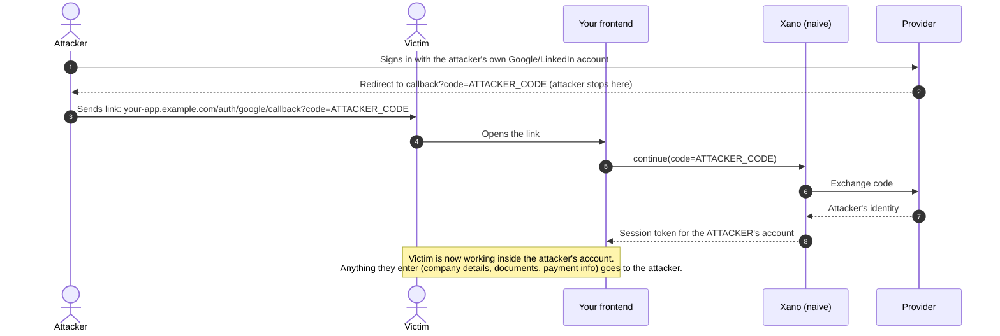
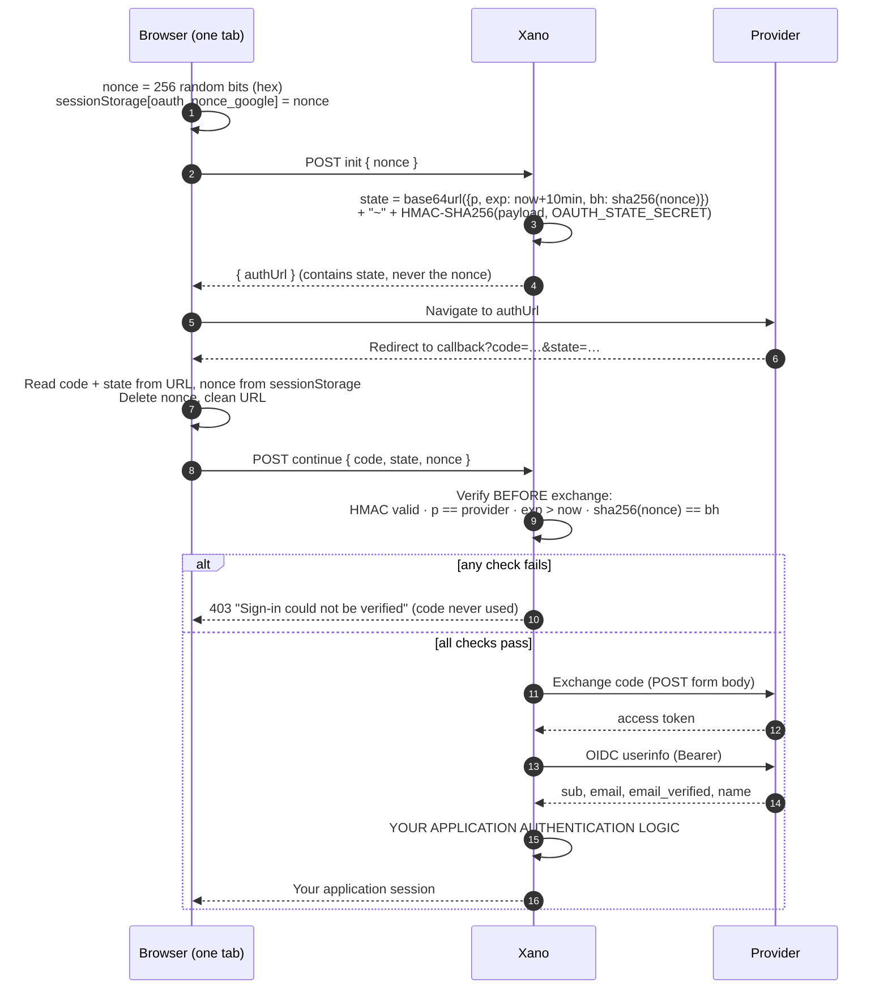

# secure-xano-oauth

A reference implementation of **login-CSRF-resistant Google and LinkedIn sign-in** for apps that use
[Xano](https://www.xano.com) as the backend and their own frontend (WeWeb, React, Vue, plain JS, etc.).

The pattern binds each OAuth callback to the browser that started the sign-in. It needs no server-side
state table:

- the browser generates a **256-bit nonce** and keeps it in `sessionStorage`
- Xano issues an **HMAC-signed `state`** that carries only the nonce's SHA-256 hash, the provider and an expiry
- on the callback, Xano **verifies the state against the browser's nonce before exchanging the authorization code**

This repository stops once it has a **verified provider identity**. Connecting that identity to your
users, accounts and sessions is your application's job. The `continue` endpoints **fail closed** until
you implement that step (see [Your integration boundary](#your-integration-boundary)).

> This is reference code, not a drop-in auth product. Read the [limitations](#12-security-limitations-and-your-responsibilities)
> before you ship it.

---

## Contents

1. [The login-CSRF problem in a naive OAuth flow](#1-the-login-csrf-problem-in-a-naive-oauth-flow)
2. [The attack scenario](#2-the-attack-scenario)
3. [The hardened architecture](#3-the-hardened-architecture)
4. [Why the nonce stays in the browser and out of URLs](#4-why-the-nonce-stays-in-the-browser-and-out-of-urls)
5. [Why the state is signed](#5-why-the-state-is-signed)
6. [Why verification happens before the code exchange](#6-why-verification-happens-before-the-code-exchange)
7. [How Google and LinkedIn differ](#7-how-google-and-linkedin-differ)
8. [Required environment variables](#8-required-environment-variables)
9. [Frontend setup](#9-frontend-setup)
10. [Xano setup](#10-xano-setup)
11. [Testing and failure cases](#11-testing-and-failure-cases)
12. [Security limitations and your responsibilities](#12-security-limitations-and-your-responsibilities)

Further reading: [docs/architecture.md](docs/architecture.md) · [docs/threat-model.md](docs/threat-model.md) · [docs/setup.md](docs/setup.md)

---

## 1. The login-CSRF problem in a naive OAuth flow

A common Xano OAuth setup looks like this:

1. `init` returns the provider's authorization URL, with `state` empty or missing.
2. The user signs in at Google or LinkedIn and is sent back to `https://your-app.example.com/auth/google/callback?code=…`.
3. The callback page sends `code` to `continue`, which exchanges it, finds or creates the user and returns a session token.

Nothing in this flow checks that **the browser finishing the sign-in is the one that started it**. Any
valid authorization code works on any browser's callback page. That is **login CSRF**: an attacker can
sign a victim into an account the attacker controls.

## 2. The attack scenario



Authorization codes stay valid for a short but usable window, long enough to deliver such a link. Checks like
"is the user active" or "is the email verified" don't help, because the attacker's account passes them.

## 3. The hardened architecture



Replayed against this design, the attacker's link carries the attacker's `state`, which is bound to the
hash of the attacker's nonce. The victim's browser can only send its own nonce, or nothing at all, so
verification fails and no session is issued. The attacker cannot plant a nonce in the victim's
`sessionStorage` from another site.

## 4. Why the nonce stays in the browser and out of URLs

The security comes from one fact: **the attacker can supply the `state` (in the link) but cannot supply
the victim's nonce**. That only holds if the nonce never travels where an attacker can set or read it:

- **Not in the provider URL or the callback URL.** If the nonce came back on the callback URL, the
  attacker's link would include the attacker's nonce, and the check would pass. Only the *hash* goes
  into `state`.
- **Not in any URL at all.** `init` and `continue` are `POST` endpoints with JSON bodies, so the nonce
  stays out of browser history, Referer headers, proxy logs and server access logs.
- **In `sessionStorage`, not `localStorage` or a cookie.** `sessionStorage` is scoped to one tab and one
  origin, survives the same-tab round trip to the provider, and is cleared when the tab closes. Another
  site cannot write it. A cookie on the Xano domain would be a third-party cookie from your frontend's
  point of view, which browsers may block.
- **Used once.** The callback deletes the nonce as soon as it reads it, whatever happens next.

A frontend bug that sent the URL `state` as the "nonce" still fails safely, because `sha256(state) ≠ bh`.

## 5. Why the state is signed

The state is a signed token (`payload~signature`), not a random string stored on the server:

- **Integrity.** Only Xano knows `OAUTH_STATE_SECRET`, so nobody else can mint a state or change the
  nonce hash, provider or expiry inside one.
- **Provider binding.** A state issued for Google is refused on the LinkedIn callback, and vice versa.
- **Expiry.** A state is valid for 10 minutes. Rotating the secret invalidates only states still in flight.
- **No storage.** There's no state table to create, clean up or migrate.

## 6. Why verification happens before the code exchange

`continue` runs `oauth_state_verify` as its **first** step. A forged, mismatched, expired or
cross-provider callback is refused before Xano talks to the provider:

- the authorization code is never redeemed by an unverified request;
- no provider tokens are obtained and no identity is fetched for a request you will refuse anyway;
- every failure returns the same generic 403, so probing reveals nothing about which check failed.

## 7. How Google and LinkedIn differ

| | Google | LinkedIn |
|---|---|---|
| Authorization endpoint | `https://accounts.google.com/o/oauth2/v2/auth` | `https://www.linkedin.com/oauth/v2/authorization` |
| Scopes | `openid email profile` | `openid profile email` |
| Token endpoint | `POST https://oauth2.googleapis.com/token` | `POST https://www.linkedin.com/oauth/v2/accessToken` |
| Userinfo endpoint | `GET https://openidconnect.googleapis.com/v1/userinfo` | `GET https://api.linkedin.com/v2/userinfo` |
| User ID claim | `sub` | `sub`, specific to your LinkedIn app |
| Cancel / deny on callback | `error` parameter | `error` parameter (different codes) |

These endpoints come from each provider's OpenID Connect discovery document
([Google](https://accounts.google.com/.well-known/openid-configuration),
[LinkedIn](https://www.linkedin.com/oauth/.well-known/openid-configuration)). Check them there if a call
starts failing.

Both return `state` unchanged on the callback, and both are normalized to the same identity shape:
`{provider, provider_user_id, email, email_verified, name}`. Differences that matter for your integration:

- **The user ID can be app-specific.** LinkedIn issues a different `sub` per LinkedIn app, so switching to
  a new LinkedIn app changes every user's ID. Keep the same app, or plan a migration.
- **The email claims can be missing.** LinkedIn documents `email` and `email_verified` as optional. The
  identity functions report a missing `email_verified` as `false`.

The architecture does not depend on provider-specific code lifetimes or on PKCE. PKCE support differs by
provider and app type, so this repo uses the same signed-state binding for both providers. You can add
PKCE where your provider supports it; it complements the browser binding described here but does not
replace it.

## 8. Required environment variables

Set these as **workspace environment variables** in Xano (Settings → Environment Variables). Never commit
their values.

| Variable | Example / format | Used by |
|---|---|---|
| `GOOGLE_CLIENT_ID` | `GOOGLE_CLIENT_ID` from the Google Cloud console | auth URL, code exchange |
| `GOOGLE_CLIENT_SECRET` | `GOOGLE_CLIENT_SECRET` | code exchange |
| `GOOGLE_REDIRECT_URI` | `https://your-app.example.com/auth/google/callback` | auth URL, code exchange |
| `LINKEDIN_CLIENT_ID` | `LINKEDIN_CLIENT_ID` from the LinkedIn developer portal | auth URL, code exchange |
| `LINKEDIN_CLIENT_SECRET` | `LINKEDIN_CLIENT_SECRET` | code exchange |
| `LINKEDIN_REDIRECT_URI` | `https://your-app.example.com/auth/linkedin/callback` | auth URL, code exchange |
| `OAUTH_STATE_SECRET` | 64 hex characters: `openssl rand -hex 32` | state signing and verification |

- Redirect URIs are read **only on the server** and must match the provider console **exactly** (scheme,
  host including `www`, path, trailing slash).
- `OAUTH_STATE_SECRET` must be at least 64 characters. Shorter or missing values make `init` and
  `continue` fail with "OAuth state signing is not configured."
- Xano environment variables are workspace-wide, so every branch uses the same values.

## 9. Frontend setup

The four files in [`frontend/`](frontend/) are framework-free ES modules:

| File | Run it… |
|---|---|
| `google-start.js` / `linkedin-start.js` | when the user clicks "Sign in with …" |
| `google-callback.js` / `linkedin-callback.js` | once, when the callback page loads |

1. Set `OAUTH_API_BASE` in each file to your Xano API base and API group canonical.
2. Serve each callback page at the path you set in `GOOGLE_REDIRECT_URI` / `LINKEDIN_REDIRECT_URI`.
3. **Use the same origin for start and callback.** `https://example.com` and `https://www.example.com`
   are different origins with separate `sessionStorage`. A mismatch shows up as "Sign-in expired".
4. Start and callback must happen **in the same tab**. The start scripts use `window.location.assign`;
   don't open the provider in a popup or new tab.
5. Add `<meta name="referrer" content="no-referrer">` to the callback pages.
6. Make sure the callback logic runs **once** per page load. The first run deletes the nonce and removes
   `code` and `state` from the URL, so a second run (for example from React Strict Mode running effects
   twice in development, or from reloading the callback page) sees no `code` or `state` and fails safely
   with "Invalid sign-in response. Please try again." without calling Xano. "Sign-in expired" means
   something different: `code` and `state` are present but this browser holds no nonce (another tab,
   browser or origin, or a link someone sent you).
7. Store whatever `continue` returns (your session) the way your app normally stores sessions.

**Low-code builders (for example WeWeb):** paste the body of the start function into a custom JavaScript
action on the sign-in button, and the body of the callback function into a custom JavaScript action that
runs on callback page load. Use code, not a builder-managed variable, for the nonce, so it lives only
in `sessionStorage` and never in a URL or a persisted variable.

## 10. Xano setup

Full steps are in [docs/setup.md](docs/setup.md). In short:

1. Create the seven environment variables above.
2. Create the six functions in [`xano/functions/`](xano/functions/).
3. Create the two API groups in [`xano/api/`](xano/api/) with canonicals unique on your instance, and the
   `init` / `continue` POST endpoints in each.
4. Register the redirect URIs in the Google Cloud console and the LinkedIn developer portal.
5. **Implement your application authentication logic** in both `continue` endpoints.

You can paste the `.xs` files into Xano's XanoScript editor, or push them with the Xano CLI.

### Your integration boundary

Each `continue` endpoint contains this block:

```
// YOUR APPLICATION AUTHENTICATION LOGIC HERE
// $identity = {provider, provider_user_id, email, email_verified, name}
var $app_session { value = null }
precondition ($app_session != null) { error = "Application authentication is not implemented." }
response = $app_session
```

`$identity` is the provider's verified identity. **It is not an application session**, and must never be
returned to the browser as proof of sign-in. Replace the block with your own logic, which should:

- look up the user linked to `(provider, provider_user_id)`. Use the provider's `sub`, not the email,
  and remember it can be specific to your OAuth app;
- never attach a provider identity to an existing user **by email alone** unless the provider reports
  `email_verified` *and* your app has verified that email (otherwise someone who registers your user's
  email at a provider can take over the account);
- create users on first sign-in only if your app allows sign-up;
- refuse banned, deactivated or otherwise blocked users;
- issue your own session (for example with `security.create_auth_token`) and return what your frontend
  expects.

Until you do, both endpoints return an error after verifying the state, so an incomplete setup cannot be
used to sign anyone in.

## 11. Testing and failure cases

[docs/setup.md](docs/setup.md#testing) has `curl` commands for each case. The expected behaviour:

| Case | Expected result |
|---|---|
| `init` with a valid 64-hex nonce | 200 `{authUrl}`; the URL contains `state`, not the nonce |
| `init` with a missing or malformed nonce | 400 |
| `continue`, state + nonce from the same browser, real code | verification passes; until you implement the boundary: error "Application authentication is not implemented." |
| `continue`, valid state + nonce, fake code | 403 "Sign-in with Google/LinkedIn failed" (verification passed, the provider refused the code) |
| Wrong nonce | 403 "Sign-in could not be verified", code not used |
| Missing or empty state or nonce | 400 "Missing param: …" (Xano treats an empty required input as missing); refused before the exchange |
| Tampered payload or signature | 403 "Sign-in could not be verified" |
| Google state on the LinkedIn callback (or vice versa) | 403 "Sign-in could not be verified" |
| State older than 10 minutes | 403 "Sign-in could not be verified" |
| Attacker's callback link opened in another browser | callback page stops with "Sign-in expired" (no nonce); if forced, 403 |
| `OAUTH_STATE_SECRET` missing or short | 500 "OAuth state signing is not configured." |

Also test the real flow end to end for both providers, cancelling at the provider (the callback receives an
`error` parameter; the exact code differs by provider), and a callback opened in a new tab.

## 12. Security limitations and your responsibilities

What this pattern **does**: binds each callback to the starting browser tab, rejects forged, tampered,
expired and cross-provider states, and keeps provider secrets and tokens on the server.

What it **does not** do:

- **XSS on your frontend origin defeats it.** Script running on your origin can read `sessionStorage`.
  Use a Content Security Policy and keep third-party scripts off your sign-in and callback pages.
- **No server-side single use.** A state can be verified more than once within its 10 minutes. Replay is
  limited by the provider's single-use codes and by the browser deleting the nonce, and an attacker can
  never obtain the victim's nonce. If you need strict single use, record used state signatures until expiry.
- **The HMAC comparison is a plain string comparison.** Xano has no constant-time compare. Timing attacks
  over the network against a 256-bit HMAC are not considered practical, but this is weaker than a
  constant-time check.
- **It does not authenticate users in your app.** Account linking, sign-up policy, blocked users,
  session lifetime and revocation, and post-login redirects (avoid open redirects) are yours.
- **It does not rate-limit.** `init` and `continue` are public endpoints. Add rate limiting or bot
  protection appropriate to your app.
- **CORS is your configuration.** Xano's default CORS behaviour may reflect any requesting origin. In each
  OAuth API group's CORS settings, allow only your actual frontend origin. This is defense in depth: it
  narrows which sites can call the endpoints from a browser, but it is not a substitute for the
  nonce/state binding, which is what stops login CSRF.
- **Secret handling is yours.** Generate `OAUTH_STATE_SECRET` locally, store it only in Xano, and rotate it
  if it is ever exposed (rotation only invalidates sign-ins in progress).
- **Provider behaviour can change.** Re-check provider endpoints, scopes and claims against their current
  documentation.

See [docs/threat-model.md](docs/threat-model.md) for the full analysis and the alternatives considered.

## License

[MIT](LICENSE) © Jesús Perales Elizondo
