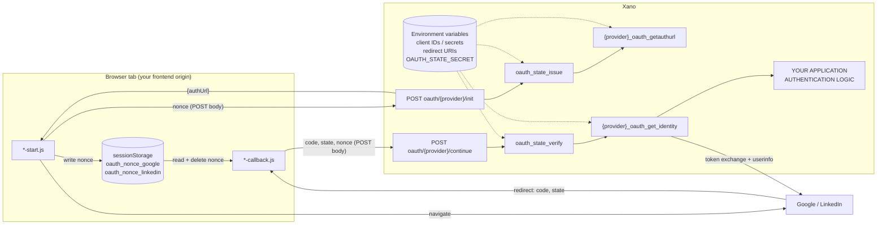

# Architecture

## Components



## The state token

```
state = base64url(JSON payload) + "~" + hex(HMAC-SHA256(base64url(JSON payload), OAUTH_STATE_SECRET))

payload = {
  "p":   "google" | "linkedin",   // provider binding
  "exp": <ms timestamp>,          // issued-at + 600 s
  "bh":  sha256_hex(nonce)        // browser binding; the raw nonce is never included
}
```

- The signature covers the encoded payload exactly as transmitted, so it is checked **before** decoding.
- `~` is the separator because it cannot appear in base64url or hex. Xano's `base64_encode_urlsafe` pads
  with `.`, so `.` would be ambiguous as a separator.
- A typical state is about 200 characters, well within URL limits.

## Request flow

### Start (`init`)

1. The browser generates `nonce` = 32 random bytes as 64 lowercase hex characters (`crypto.getRandomValues`).
2. It stores the nonce in `sessionStorage` under a provider-specific key.
3. `POST oauth/{provider}/init { nonce }`.
4. `oauth_state_issue` checks the nonce format and the provider allowlist, then returns the signed state.
5. `{provider}_oauth_getauthurl` builds the provider URL with the server-side client ID, redirect URI,
   OIDC scopes and the state.
6. The response is `{authUrl}`. The browser checks the URL points at the provider, then navigates the
   same tab to it.

### Callback (`continue`)

1. The provider redirects to the redirect URI with `code` and `state`, or with `error`.
2. The callback script reads `code` and `state` from the URL and the nonce from `sessionStorage`. It
   **deletes the nonce** and removes the query string from the address bar.
3. If the provider returned an error, or the nonce is missing, it stops without calling Xano.
4. `POST oauth/{provider}/continue { code, state, nonce }`.
5. `oauth_state_verify` (first statement) checks the signature, provider, expiry and nonce hash. Any
   failure is a generic 403, and the code is never used.
6. `{provider}_oauth_get_identity` exchanges the code (POST form body with the server-side secret and
   redirect URI), calls the OIDC userinfo endpoint with a Bearer token, and returns
   `{provider, provider_user_id, email, email_verified, name}`. Provider tokens are not returned.
7. **Your application authentication logic** turns the identity into a session. Until you implement
   it, the endpoint fails closed.

## Error responses

| Source | Status | Message |
|---|---|---|
| Missing or short `OAUTH_STATE_SECRET` | 500 | OAuth state signing is not configured. |
| Missing provider env vars | 500 | Google/LinkedIn sign-in is not configured. |
| Missing or empty required input (`nonce`, `code`, `state`) | 400 | Missing param: … (returned by Xano before the stack runs) |
| Malformed nonce on `init` | 400 | Invalid sign-in request. Please try again. |
| Any state verification failure | 403 | Sign-in could not be verified. Please try again. |
| Provider refused the code, or userinfo failed | 403 | Sign-in with Google/LinkedIn failed. Please try again. |
| Integration boundary not implemented | 500 | Application authentication is not implemented. |

Provider error details (`error_description`, etc.) are deliberately never passed to the client.

## Design choices

- **Stateless:** no table, no cleanup job, and no schema changes in your workspace.
- **POST endpoints:** the nonce and code travel in request bodies, never in URLs.
- **Server-side redirect URIs:** the client cannot choose where codes are sent or which redirect URI the
  exchange claims.
- **One state implementation for both providers:** the `p` claim separates them.
- **Fail closed:** missing configuration, malformed input and an unimplemented integration boundary all
  produce errors, never a partial sign-in.
